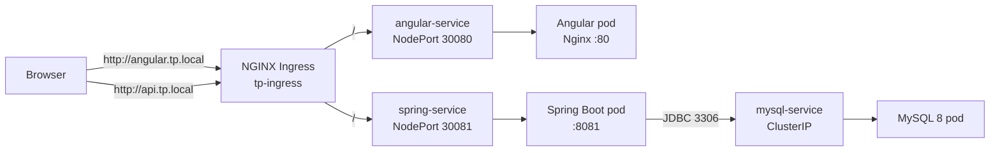

# Deployment of a Full-Stack Application on Kubernetes

A small **Angular 16 + Spring Boot 3 + MySQL 8** application deployed on Kubernetes.

The goal of this project is to demonstrate a complete containerized deployment:

- a **frontend** (Angular SPA served by Nginx),
- a **backend** (Spring Boot REST API),
- a **database** (MySQL 8),
- all wired together with Kubernetes **Deployments, Services, ConfigMap, Secret and Ingress**.

---

## Architecture



The frontend is also directly reachable through the NodePort `30080` and the API through `30081`.

## Tech stack

| Layer     | Technology                          | Version  |
| --------- | ----------------------------------- | -------- |
| Frontend  | Angular (SPA), served by Nginx      | Angular 16 / Nginx 1.17 |
| Backend   | Spring Boot (REST + Spring Data JPA)| 3.3.11 / Java 17 |
| Database  | MySQL                               | 8.0      |
| Runtime   | Docker images, Kubernetes           | -        |
| Ingress   | NGINX Ingress Controller            | -        |

## Repository structure

```
.
├── angular-app/                  # Angular 16 frontend
│   ├── Dockerfile                # Multi-stage build: Node -> Nginx
│   ├── nginx.conf                # Nginx config with SPA fallback
│   └── src/
│       ├── app/home/             # User management UI (list / add / delete)
│       ├── app/services/         # HTTP service calling the Spring API
│       └── environments/         # apiUrl configuration
├── springboot/app/               # Spring Boot API (Maven project)
│   ├── Dockerfile                # eclipse-temurin:17-jre, runs demo-0.0.1.jar
│   └── src/main/java/com/oauth/demo/
│       ├── controllers/          # UserController (/user)
│       ├── services/             # UserService
│       ├── repositories/         # UserRepository (JPA)
│       ├── entities/             # User entity
│       └── config/               # CorsConfig (origins from env)
├── k8s/                          # Kubernetes manifests
│   ├── configmap.yaml
│   ├── secret.yaml
│   ├── mysql-deployment.yaml
│   ├── spring-deployment.yaml
│   ├── angular-deployment.yaml
│   └── ingress.yaml
└── livrables-k8s.tar.gz          # Packaged deliverable (manifests + Dockerfiles + env files)
```

## The application

### Frontend (`angular-app/`)

A single page that manages a list of users:

- table of users loaded from the API,
- form to **add** a user (first name / last name),
- button to **delete** a user.

Build and runtime:

- Multi-stage `Dockerfile`: built with `node:16-alpine`, served by `nginx:1.17.1-alpine` on port `80`.
- `nginx.conf` redirects unknown routes to `index.html` (`try_files`), so Angular routing works.
- The backend URL is compiled into the bundle through `src/environments/environment.ts` / `environment.prod.ts` (`apiUrl`).

### Backend (`springboot/app/`)

Spring Boot REST API backed by Spring Data JPA and MySQL:

- configured entirely through environment variables (see `application.properties`),
- CORS origins injected from `CORS_ALLOWED_ORIGINS`,
- Actuator + Prometheus metrics exposed (`/actuator`, `/actuator/prometheus`),
- listens on port `8081`, JAR `target/demo-0.0.1.jar`.

## API endpoints

| Method | Path                 | Description                          |
| ------ | -------------------- | ------------------------------------ |
| GET    | `/user/all`          | List all users                       |
| POST   | `/user/add`          | Add a user (`{"firstName","lastName"}`) |
| DELETE | `/user/delete/{id}`  | Delete a user by id                  |
| GET    | `/actuator/prometheus` | Prometheus metrics                 |

Examples (through the Ingress):

```bash
curl http://api.tp.local/user/all

curl -X POST http://api.tp.local/user/add \
  -H "Content-Type: application/json" \
  -d '{"firstName":"Jane","lastName":"Doe"}'

curl -X DELETE http://api.tp.local/user/delete/1
```

## Kubernetes resources

| File                        | Resource(s)                                        | Details |
| --------------------------- | -------------------------------------------------- | ------- |
| `configmap.yaml`            | ConfigMap `app-config`                             | `SERVER_PORT`, `SPRING_DATASOURCE_URL`, `CORS_ALLOWED_ORIGINS`, `MYSQL_DATABASE` |
| `secret.yaml`               | Secret `app-secret` (Opaque)                       | DB username/password, MySQL root password (base64) |
| `mysql-deployment.yaml`     | Deployment + Service `mysql-service` (ClusterIP)   | `mysql:8.0`, port `3306`, `emptyDir` volume |
| `spring-deployment.yaml`    | Deployment + Service `spring-service` (NodePort)   | Image `maki1karim2hech/spring-app:1.0`, port `8081`, NodePort `30081` |
| `angular-deployment.yaml`   | Deployment + Service `angular-service` (NodePort)  | Image `maki1karim2hech/angular-app:1.0`, port `80`, NodePort `30080` |
| `ingress.yaml`              | Ingress `tp-ingress` (class `nginx`)               | `angular.tp.local` -> `angular-service:80`, `api.tp.local` -> `spring-service:8081` |

Configuration is split as recommended:

- **non-sensitive values** (ports, DB URL, CORS origins, DB name) -> `ConfigMap`,
- **sensitive values** (credentials) -> `Secret`,
- **applications** consume both as environment variables (`valueFrom`).

> The secret values in this repository are demo values only (base64 encoded, not encrypted).

## Getting started

### Prerequisites

- Docker
- `kubectl` and a Kubernetes cluster (minikube, kind, kubeadm, Vagrant...)
- NGINX Ingress Controller installed in the cluster (for the Ingress to work)
- For local builds: Java 17 (Maven wrapper included) and Node.js 16+

### 1. Build the backend image

```bash
cd springboot/app
./mvnw clean package -DskipTests
docker build -t maki1karim2hech/spring-app:1.0 .
```

### 2. Build the frontend image

```bash
cd angular-app
docker build -t maki1karim2hech/angular-app:1.0 .
```

> The frontend bakes `apiUrl` into the bundle at build time. Update
> `src/environments/environment.prod.ts` (currently `http://192.168.56.101:30081`)
> before building if your cluster IP or setup differs.

### 3. Push the images (optional)

The manifests already reference images published on Docker Hub
(`maki1karim2hech/spring-app:1.0` and `maki1karim2hech/angular-app:1.0`), so you can
skip the build/push steps to try the deployment. To use your own registry:

```bash
docker push maki1karim2hech/spring-app:1.0
docker push maki1karim2hech/angular-app:1.0
```

Then update the `image:` fields in `k8s/spring-deployment.yaml` and `k8s/angular-deployment.yaml`.

### 4. Deploy to Kubernetes

Apply the configuration first, then the workloads:

```bash
kubectl apply -f k8s/configmap.yaml
kubectl apply -f k8s/secret.yaml
kubectl apply -f k8s/mysql-deployment.yaml
kubectl apply -f k8s/spring-deployment.yaml
kubectl apply -f k8s/angular-deployment.yaml
kubectl apply -f k8s/ingress.yaml
```

Verify:

```bash
kubectl get pods,svc,ingress
```

### 5. Access the application

**Via the Ingress** - add the hosts to your machine's `hosts` file
(`C:\Windows\System32\drivers\etc\hosts` or `/etc/hosts`), pointing to the Ingress
controller IP:

```
<INGRESS_IP>  angular.tp.local  api.tp.local
```

Then open:

- Frontend: `http://angular.tp.local`
- API: `http://api.tp.local/user/all`

**Via NodePort** (no Ingress needed):

- Frontend: `http://<NODE_IP>:30080`
- API: `http://<NODE_IP>:30081`

> If you access the frontend from a URL other than the configured ones, add that
> origin to `CORS_ALLOWED_ORIGINS` in `k8s/configmap.yaml` and re-apply it.

## Local development

Backend:

```bash
cd springboot/app
SERVER_PORT=8081 \
SPRING_DATASOURCE_URL="jdbc:mysql://localhost:3306/demo" \
SPRING_DATASOURCE_USERNAME=<user> \
SPRING_DATASOURCE_PASSWORD=<password> \
./mvnw spring-boot:run
```

Frontend:

```bash
cd angular-app
npm install
npm start          # http://localhost:4200
```

## Notes and limitations

- The MySQL data volume uses `emptyDir`: **data is lost if the pod is deleted/restarted**.
  Use a `PersistentVolumeClaim` for durable storage.
- The `Secret` contains demo credentials; for production, manage secrets with a
  dedicated solution (Sealed Secrets, External Secrets, Vault...).
- Each component runs a single replica without liveness/readiness probes; these can be
  added to improve resilience.
- This is an educational project (Kubernetes lab) focused on demonstrating a full
  deployment chain: Docker builds, Deployments, Services, ConfigMap, Secret and Ingress.
